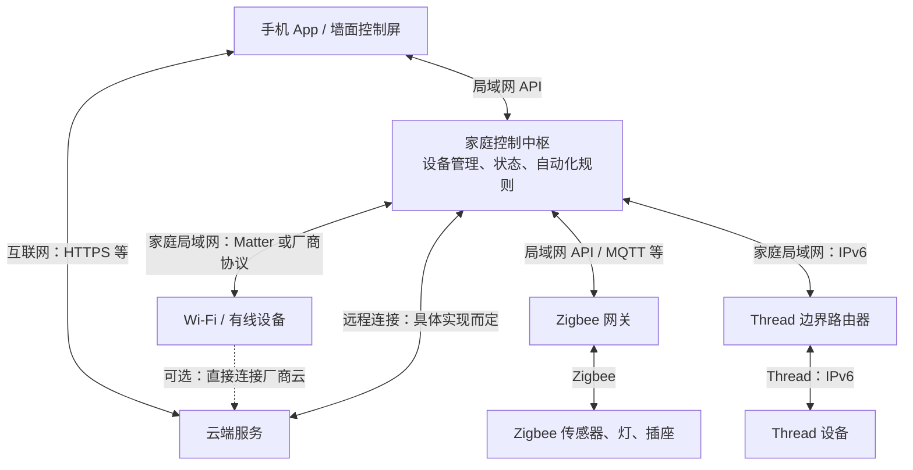

一个智能家居系统，可以拆成 **设备、通信网络、协议接入、控制平台、交互入口，以及可选的云端服务**。

理解架构时，最关键的是区分两件事：**数据怎样到达设备，以及双方怎样理解“开灯、调温度”这些指令。** Wi-Fi、Thread 主要解决前者；Matter、MQTT 等解决上层通信，但它们的职责也各不相同。

下面以一套同时接入多种设备的家庭系统为例：



这是逻辑结构，**不代表每个方框都要单独买一台机器**。例如，一台智能音箱可能同时承担语音入口、控制中枢和 Thread 边界路由器的职责。

**各部分分别做什么：**

| 部分 | 包含什么 | 核心职责 |
|---|---|---|
| 末端设备 | 门磁、温湿度计、灯、插座、窗帘、空调 | 采集状态或执行动作；内部通常有芯片和固件 |
| 家庭网络 | 路由器、Wi-Fi AP、交换机、无线 Mesh 网络 | 让设备之间能够传输数据 |
| 协议接入 | Zigbee 网关、蓝牙网关、Thread 边界路由器 | 将不同网络中的设备接入系统，具体处理方式不同 |
| 控制平台 | 厂商中枢、Home Assistant 等 | 管理设备、维护状态、执行定时和联动规则 |
| 交互入口 | 手机 App、按键、控制屏、语音助手 | 接收人的操作，展示设备状态 |
| 云端服务 | 厂商服务器或自建远程服务 | 账号、远程访问、推送、历史数据、固件更新等；是否必需取决于产品 |

其中，“网关”和“控制平台”也经常被集成到同一台设备里。

**常见协议分别处于哪一层：**

| 技术 | 主要负责什么 | 常见使用位置 |
|---|---|---|
| **Wi-Fi / 以太网** | 把设备接入 IP 网络 | 手机、中枢、摄像头、家电 |
| **Zigbee** | 一套低功耗组网和设备通信协议体系 | 门磁、人体传感器、灯、插座 |
| **Thread** | 低功耗 IPv6 Mesh 网络 | 传感器、门锁等低功耗设备 |
| **蓝牙 BLE** | 近距离通信，常使用 GATT 读写数据 | 手机直连设备、配网，或通过蓝牙网关接入 |
| **Matter** | 统一设备类型、属性、命令和安全交互 | 通过 Wi-Fi、以太网或 Thread 控制设备 |
| **MQTT** | 按“主题”发布、订阅消息 | 设备、网关、中枢、云端之间 |
| **HTTP / WebSocket** | 请求接口或持续交换消息 | App ↔ 中枢、App ↔ 云端，以及部分设备接口 |

Matter 使用现有 IP 网络；蓝牙 BLE 常用于它的初始配网。**“支持 Matter”不代表设备一定使用 Thread，也可能使用 Wi-Fi。**[Matter 官方 FAQ](https://csa-iot.org/all-solutions/matter/matter-faq/)

MQTT 通常运行在 TCP 上，可以通过 TLS 加密；它不规定消息负载必须是什么格式，所以不同厂商都用 MQTT，也不意味着设备能直接互通。[MQTT 标准](https://docs.oasis-open.org/mqtt/mqtt/v5.0/os/mqtt-v5.0-os.html)

**看三条实际链路，就容易理解它们怎样协作。**

**① 在家用手机开灯**

如果是支持本地控制的 Wi-Fi 灯：

```text
手机 App
  → 家庭 Wi-Fi / 局域网
  → 灯，或者先到家庭中枢再到灯
```

上面传输的可能是 Matter 指令，也可能是厂商自己的协议。**连着 Wi-Fi，只说明网络通了；还需要双方支持相同的控制协议。**

如果是 Zigbee 灯：

```text
手机 App
  → 局域网
  → Zigbee 网关
  → Zigbee 网络
  → 灯
```

普通手机没有 Zigbee 无线接口，因此通常通过网关接入。自建系统也可以使用“Zigbee 无线协调器＋控制软件”实现这部分功能。[Home Assistant ZHA 文档](https://www.home-assistant.io/integrations/zha/)

**② 门打开后自动开灯**

```text
门磁上报“门已打开”
  → 网关接入
  → 控制平台判断“现在是夜间”
  → 向灯发送“打开”命令
  → 灯上报新的状态
```

这里有三个不同角色：

- **传感器**产生事件。
- **规则引擎**决定是否执行动作。
- **执行器**完成动作并反馈状态。

门磁和灯可以使用不同协议，只要控制平台能够同时接入它们。规则运行在家庭中枢里时，可以实现本地联动；如果规则放在云端，则需要相应的互联网连接。

**③ 人在外面，远程开灯**

一种常见实现是：

```text
手机移动网络
  → 云端服务
  → 家中设备或中枢已建立的出站连接
  → 灯
```

设备或中枢通常主动连接云端并维持通信，所以这类方案一般不要求用户给家庭路由器配置入站端口转发。云端通信可以采用 MQTT/TLS、HTTPS、WSS 等，具体取决于厂商实现。[AWS IoT 通信协议示例](https://docs.aws.amazon.com/iot/latest/developerguide/protocols.html)

自建系统也可以通过 VPN 访问家庭中枢，例如你之前用过的 Tailscale；进入家庭网络后，再由中枢控制设备。

最后有两个容易混淆的区别：

- **Thread 边界路由器主要转发 IPv6 数据包。** Matter 指令可以穿过它，到达 Thread 设备；它本身不必理解“开灯”是什么意思。[Thread 与 IPv6](https://developers.home.google.com/matter/primer/thread-and-ipv6)
- **Matter 规定设备怎样表达能力。** 例如灯有哪些属性、支持哪些开关命令；MQTT 则主要负责消息传递，主题和消息内容仍需另外约定。[Matter 交互模型](https://developers.home.google.com/matter/primer/interaction-model)

因此，判断一套系统的架构，最有用的三个问题是：**设备通过什么网络接入、控制指令采用什么协议、自动化规则运行在家里还是云端。**
