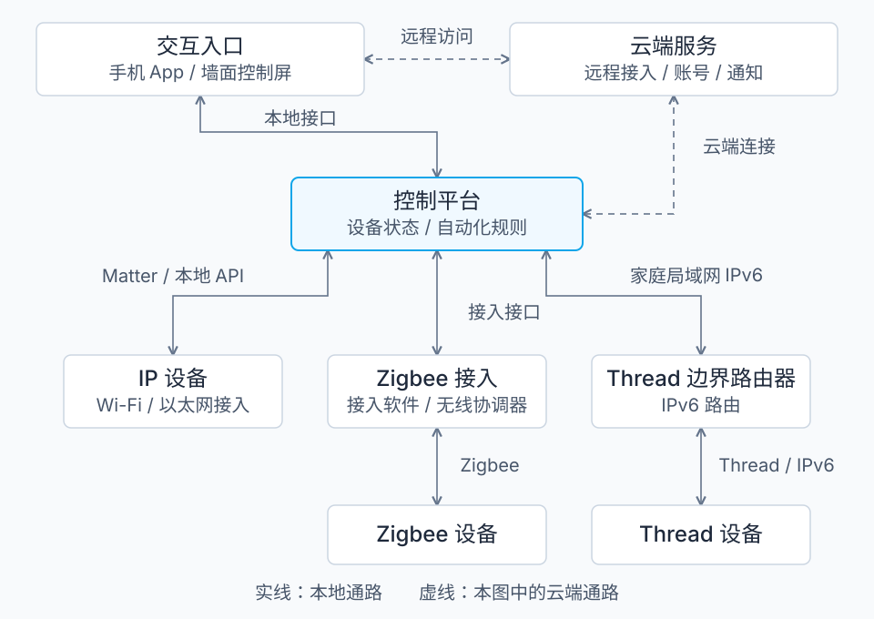

# 开篇：智能家居系统的组成与通信

夜间推开入户门，玄关灯随即亮起。这次联动至少包含三个动作：门磁检测到门已打开，规则判断当前是否需要照明，灯接收并执行开灯命令。我们还需要知道灯是否实际打开，以及哪一部分发生故障时这条链路会中断。

智能家居系统把家庭中的感知、控制和人机交互连接起来，使设备能够接受操作、报告状态，并按规则协同工作。设计这样的系统，需要分别描述参与者的职责、它们之间的数据通路，以及每一段通信采用的协议。把这些关系画清楚，才能判断延迟出现在哪里、断开互联网后还剩哪些功能，以及控制权限应由谁持有。

本篇以“夜间开门后亮灯”为贯穿示例，建立一个不依赖特定品牌的系统模型。读完后，你可以追踪一次控制从输入到执行结果的路径，并指出路径中的网络、协议和运行依赖。模型先讨论单个家庭内的设备控制；视频传输、多住宅管理和完整的身份认证过程留待各自主题展开。

## 1. 从一次联动识别系统角色

门磁把物理变化转成数据，灯把控制命令转成物理动作。它们分别承担*传感器（sensor）*和*执行器（actuator）*的职责，合称末端设备。设备内部的固件负责采样、通信和动作执行；同一个产品也可以同时承担这两种职责，例如带电量计量的智能插座。

门磁的数据要传到判断规则的位置，命令还要传到灯。我们把提供这些通路的设施称为家庭通信网络；把接收事件、维护设备状态并执行规则的软件称为*控制平台（controller platform）*。用户通过手机、墙面按键或语音入口发出操作。需要远程访问、账号服务或消息推送时，系统还可能连接云端。

| 系统角色 | 承担的工作 | 在开门亮灯中的位置 |
|---|---|---|
| 末端设备 | 感知环境、报告状态、执行动作 | 门磁报告开门，灯执行开灯 |
| 家庭通信网络 | 提供局域网连接、无线转发和 IP 路由 | 传递门磁事件与开灯命令 |
| 协议接入 | 将设备网络接入平台；必要时转换协议和数据模型 | 接入 Zigbee 门磁或 Thread 灯 |
| 控制平台 | 维护状态、判断条件、执行规则 | 判断是否处于夜间并发出命令 |
| 交互入口 | 接受用户操作，展示状态和执行结果 | 配置联动、手动开灯、查看结果 |
| 云端服务 | 提供远程接入、账号、通知、更新等服务 | 按产品设计参与远程控制或通知 |

这些是逻辑角色，物理设备的数量由实现决定。一台家庭中枢可以同时运行控制平台和协议接入服务；一台智能音箱也可能集成网络接入和控制功能。分析系统时，应分别标出各个角色，再说明它们部署在哪台机器上。

图 1 展示了一种包含多种接入方式的参考拓扑。实线表示本地通路，虚线表示示例中的云端通路；具体系统可以只采用其中一部分。

*图 1：逻辑角色与通信通路。家庭局域网简化为连线；图中的方框可以合并部署，双向箭头表示交互能力。Thread 路径中的 Matter 会话终点位于控制端和设备端。*

## 2. 从网络连接到控制语义

一条开灯指令必须同时满足两个条件：数据能够到达目标，目标能够理解数据的含义。前一个条件涉及无线连接、网络寻址和路由；后一个条件涉及设备能力、命令格式和交互规则。

*Wi-Fi* 和以太网提供 IP 网络的接入方式。家庭局域网中的 TCP 或 UDP 数据可以经由它们传输，但开灯、调光、读温度等含义要由上层协议规定。同样连接 Wi-Fi 的两台设备，是否能够相互控制，还取决于它们采用的应用协议和授权方式。

*Thread* 提供低功耗 IPv6 Mesh 网络，使传感器等设备能够在功耗受限的条件下交换 IP 数据。*Matter* 则在 IP 网络上定义设备类型、属性、事件、命令和安全交互。Matter 的工作通信可以运行在 Wi-Fi、以太网或 Thread 上；蓝牙低功耗 BLE 常用于初始配网。[Matter 官方 FAQ][matter-faq] 和 [Thread 与 IPv6][thread-ipv6] 分别说明了这两层的职责。

| 技术 | 在系统中的职责 | 需要另行确定的部分 |
|---|---|---|
| Wi-Fi、以太网 | 为设备提供 IP 网络接入 | 采用哪种设备控制协议 |
| Thread | 提供低功耗 IPv6 Mesh 网络 | 承载哪种应用协议、如何连接家庭局域网 |
| Zigbee | 提供低功耗组网及设备交互协议体系 | 平台如何接入设备能力和厂商扩展 |
| BLE | 提供近距离通信，设备可通过 GATT 服务与特征交换数据 | 数据含义、配网流程和平台接入方式 |
| Matter | 规定基于 IP 的设备模型和安全交互 | 所需功能是否属于设备与平台支持的能力范围 |
| MQTT | 经消息代理按主题发布、订阅消息 | 主题名称、消息格式和设备语义 |
| HTTP、WebSocket | 提供请求接口或持续交换消息的方式 | API、消息结构、身份和权限约定 |

表中的技术跨越不同层次。Zigbee 涵盖组网及上层设备交互；Matter 和 Thread 可以组合使用；MQTT 又可以运行在通过 Wi-Fi 接入的 IP 网络上。设计文档应把组合关系写出来，例如“以太网接入的中枢，通过 Matter 控制 Thread 灯”。

*MQTT* 采用发布／订阅模型：客户端把消息发布到主题，*消息代理（broker）*把消息转交给相应订阅者。它通常运行在 TCP 上，可以配合 TLS 加密传输；消息负载的业务含义由使用方约定。两个平台都支持 MQTT，仍然需要就主题、数据格式和命令含义达成一致。[MQTT 5.0 标准][mqtt-spec] 定义了这种消息传递模型。

Matter 把设备交互进一步组织成可识别的属性、事件和命令。例如，控制端可以调用灯的开关命令，并订阅开关属性的变化。它的互操作性仍受设备类型、可选功能及平台实际支持范围限制。[Matter 交互模型][matter-interaction] 给出了相应的数据路径和操作定义。

## 3. 接入不同网络时发生什么

如果门磁使用 Zigbee，接入端需要具备 Zigbee 无线通信能力。*Zigbee 协调器（coordinator）*负责组建网络等职责；上层接入软件把设备的属性、事件和命令映射到控制平台。它们可以集成在网关中，也可以由无线适配器与主机软件共同实现。[ZHA 文档][zha] 描述了后一种接入方式。

Thread 设备接入家庭 IP 网络时，使用*Thread 边界路由器（Thread Border Router）*。它在 Thread 网络与 Wi-Fi 或以太网之间提供 IP 路由。控制端和设备端可以保持同一个 Matter 会话，边界路由器无需把“开灯”翻译成另一种设备命令。[Thread 边界路由器说明][border-router] 给出了这一职责边界。

这两种接入方式决定了不同的故障定位方法。Zigbee 事件已到达网关、平台却没有更新状态时，需要检查设备接入与数据映射。Thread 网络内仍能通信、家庭局域网却无法访问设备时，需要检查边界路由、网络发现和网络配置。连接恢复后，应用身份与权限仍需独立成立。

## 4. 同一设备的三种控制路径

### 本地手动控制

用户在家里用手机开灯时，可以由 App 经局域网直接访问支持本地控制的灯，也可以先访问控制平台，再由平台下发命令。具体设备可能采用 Matter、本地 HTTP API 或厂商协议。图 1 中，Thread 灯的路径为“交互入口 → 控制平台 → Thread 边界路由器 → 灯”；Matter 消息由控制端和灯处理。

局域网存在，并不足以保证产品提供本地控制接口。设计时要确认每个必需接口是否本地可用，以及身份凭据和名称解析是否另有云端依赖。

### 本地自动化联动

开门亮灯的规则可以部署在家庭控制平台上。门磁上报事件后，平台读取判断所需的状态，决定是否向灯发送命令。手机只负责配置和观察，执行这条规则时不必始终在线。

如果门磁使用 Zigbee、灯使用 Matter，两端的协议可以不同：平台通过各自的接入服务理解门磁事件并调用灯的能力。协议转换、规则判断和命令发送是三个可分别定位的步骤。

### 远程控制

人在外面时，一种常见结构是“手机 → 云端服务 → 家庭中枢或设备 → 灯”。家庭端主动建立出站连接，云端利用该连接传递消息；这种结构一般无需用户在家庭路由器上配置入站端口转发。远程访问也可以通过 VPN 接入家庭网络，再访问本地平台。

设备与云端之间可以采用 MQTT/TLS、HTTPS 或安全 WebSocket，具体选择由服务实现决定。[AWS IoT 协议说明][aws-protocols] 是一种公开实现的例子。Wi-Fi 设备也可以直接维持与云端的连接，由设备接收远程命令，因此远程控制不一定经过独立的家庭中枢。

## 5. 综合：沿着开门亮灯追踪状态

假设规则在本地运行：门磁报告从“关闭”变为“打开”时，若当前处于夜间，就把原本关闭的灯打开。为了观察主要步骤，本例先假设连接、身份和权限正常，暂不加入重试、重复事件和多人同时操作。

| 步骤 | 系统中的变化 | 能够确认的事实 |
|---|---|---|
| 1. 门磁检测到开门 | 门磁本地状态变为“打开” | 设备检测到了物理变化 |
| 2. 平台收到报告 | 平台记录门已打开及报告时间 | 这次状态报告到达了平台 |
| 3. 规则判断条件 | 夜间条件满足，生成开灯动作 | 平台决定发出开灯命令 |
| 4. 灯收到并处理命令 | 灯尝试改变输出，返回协议规定的结果 | 应用层报告了相应处理结果 |
| 5. 平台收到灯的状态 | 平台记录灯为“打开” | 设备报告的状态已更新 |

每一步的确认范围都有限。传输层或消息代理的确认可以说明某段消息交付情况；应用层执行结果和设备状态报告提供另一层证据。若需要确认房间实际达到预期照度，还需要适当的物理观测。设计中应明确“命令已发送”“设备报告已打开”和“实际照明满足要求”分别由什么证据判定。

现在撤销本例中“连接始终正常”的假设。如果断开互联网，而事件接入、规则、判断所需的时钟、授权和动作接口都在家中可用，本地联动可以继续执行；远程控制和云端通知则可能中断。若规则迁到云端，云连接就进入了这条联动的必需路径。若中枢掉电，本例中部署于中枢的规则会停止，独立配置的设备直连、绑定或墙面物理开关则要按各自路径判断。

这提供了一种分析方法：为每项功能列出必需的设备、进程、通信链路和外部服务，再逐项移除一个依赖，判断执行路径是否仍然完整。本地部署缩短了部分外部依赖，也把运行维护与故障恢复的责任留在家庭端；允许云端参与，则需要确定哪些数据和控制权限跨越家庭边界。

*自检：* 如果仅把规则判断移到云端，门磁和灯仍然在家里，断开互联网后本例能否自动开灯？

*解答：* 不能按该路径完成自动开灯。事件必须到达云端才能触发判断，开灯动作也必须返回家中。末端设备留在家里，并不能替代已迁出的规则执行环节。若另有独立的本地规则或设备绑定，需将它们作为另一条路径分析。

## 6. 从参考模型进入设计

一份原理设计应能够标出每项功能的执行位置，画出事件、命令和状态的路径，注明每段链路的协议，并列出运行依赖及确认结果所需的证据。在这个模型上，设备选型、软件部署和网络配置才有可核对的依据。

开篇建立的是角色和通路模型。后续研究可以沿着同一个联动展开：怎样表示设备能力与状态，怎样区分命令与观测结果，怎样处理消息重复和设备重启，以及怎样限制不同用户和服务的控制权限。

## 参考资料

以下资料用于核对协议和公开实现的职责。图 1 与开门亮灯过程是据此归纳的参考模型，不代表某个厂商的固定架构。资料核对日期：2026-11-06。

1. [CSA：Matter FAQ][matter-faq]。说明 Matter 与现有网络技术、配网方式的关系。
2. [Google Home：Thread and IPv6][thread-ipv6]。说明 Matter 的 IPv6 通信和 Thread 网络接入。
3. [Thread Group：Securing Your IoT Network — How Border Routers Help][border-router]。说明边界路由器的 IP 路由职责。
4. [OASIS：MQTT Version 5.0，2019-03-07 标准版][mqtt-spec]。定义发布／订阅、主题、消息交付和负载边界。
5. [Google Home：Interaction Model Concepts][matter-interaction]。说明 Matter 的属性、事件和命令交互。
6. [Home Assistant：Zigbee Home Automation][zha]。提供协调器与设备接入软件的公开实例。
7. [AWS IoT Core：Device communication protocols][aws-protocols]。提供 MQTT、HTTPS、WSS 和 TLS 的云端通信实例。

[matter-faq]: https://csa-iot.org/all-solutions/matter/matter-faq/
[thread-ipv6]: https://developers.home.google.com/matter/primer/thread-and-ipv6
[border-router]: https://threadgroup.org/Newsroom/Blog/securing-your-iot-network-how-border-routers-help
[mqtt-spec]: https://docs.oasis-open.org/mqtt/mqtt/v5.0/os/mqtt-v5.0-os.html
[matter-interaction]: https://developers.home.google.com/matter/primer/interaction-model
[zha]: https://www.home-assistant.io/integrations/zha/
[aws-protocols]: https://docs.aws.amazon.com/iot/latest/developerguide/protocols.html
